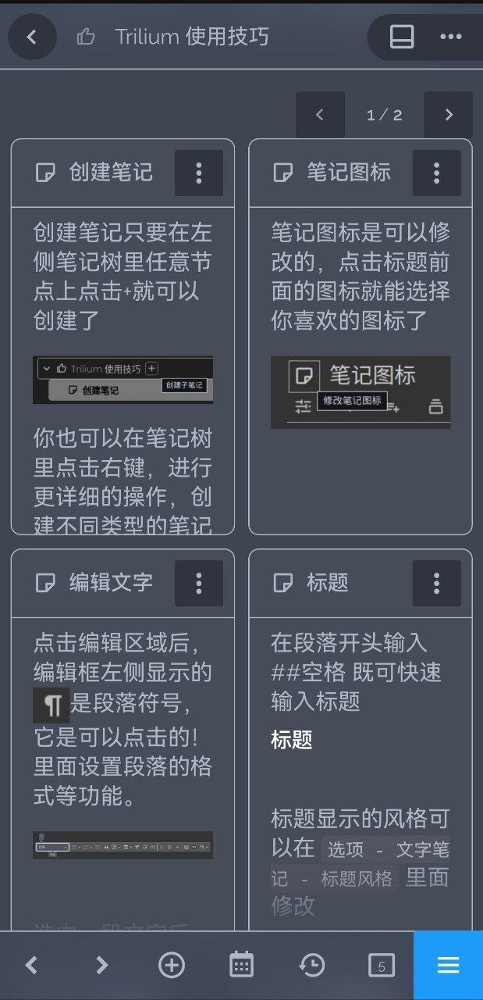

# TriliumZro

[TriliumNext](https://github.com/TriliumNext/Trilium) 的第三方 Android 客户端外壳：一个只做界面增强的 WebView 壳。

**服务器端与网页端一行都不改。** 所有改动都在客户端的注入层（CSS / JS 注入到 WebView），换到浏览器、官方桌面版或其他客户端，服务器返回的东西与原来完全一致；服务器升级降级也不受影响。

> 非官方项目，与 Trilium / TriliumNext 团队无关。

## 做了什么

| 位置 | 改动 |
| --- | --- |
| 顶栏 / 底栏 | 磨砂玻璃（`backdrop-filter`），内容从栏下方滚过；只在内容真的滚到栏底下时才出现。内容少的笔记也补了一点滚动余量，同样能上滑把大标题推上去 |
| 滚动条 | 隐藏原生滚动条，自绘 4px 细指示条，空闲淡出 |
| 标题栏右侧 | 两个图标合并成一块（左端半圆、右侧贴边），图标垂直居中 |
| 编辑态 | 格式工具栏出现时底栏保持磨砂，工具栏停在底栏上方、不再互相遮挡；键盘弹出底栏收起时，工具栏跟着落回原位，不留空行 |
| 兼容性 | 补齐 `Set` 代数方法、Iterator helpers、`toReversed`、`Object.groupBy`、`Promise.withResolvers` 等新 API，老 WebView 不再整页报错 |

## 不做什么

- 不改服务器、不改网页端：菜单项、关于页的额外内容全部由客户端在本地渲染
- 不收集不上报任何数据

## 使用

1. 从 [Releases](https://github.com/rp168/TriliumZro/releases) 下载 `TriliumZro-Android-v版本号.apk`（Android 8.0 / API 26 及以上）安装
2. 首次启动没有内置地址时，会显示「连不上服务器」页 →「服务器设置 / 登录」里填服务器地址和密码
3. 之后与网页端一致：树、笔记、编辑、搜索都在原来的位置，只是界面更贴近手机原生

## 已知限制

- 只针对手机竖屏调优，平板与横屏基本是原样
- 注入依赖 TriliumNext 的 DOM 结构（`.title-row`、`#mobile-bottom-bar`、`.about-dialog`、`.classic-toolbar-island` 等），上游大改版后可能需要跟进
- 老 WebView（如鸿蒙系统 WebView）下部分效果会退化成纯色

## 许可

AGPL-3.0，与 TriliumNext 上游保持一致。见 [LICENSE](LICENSE)。
